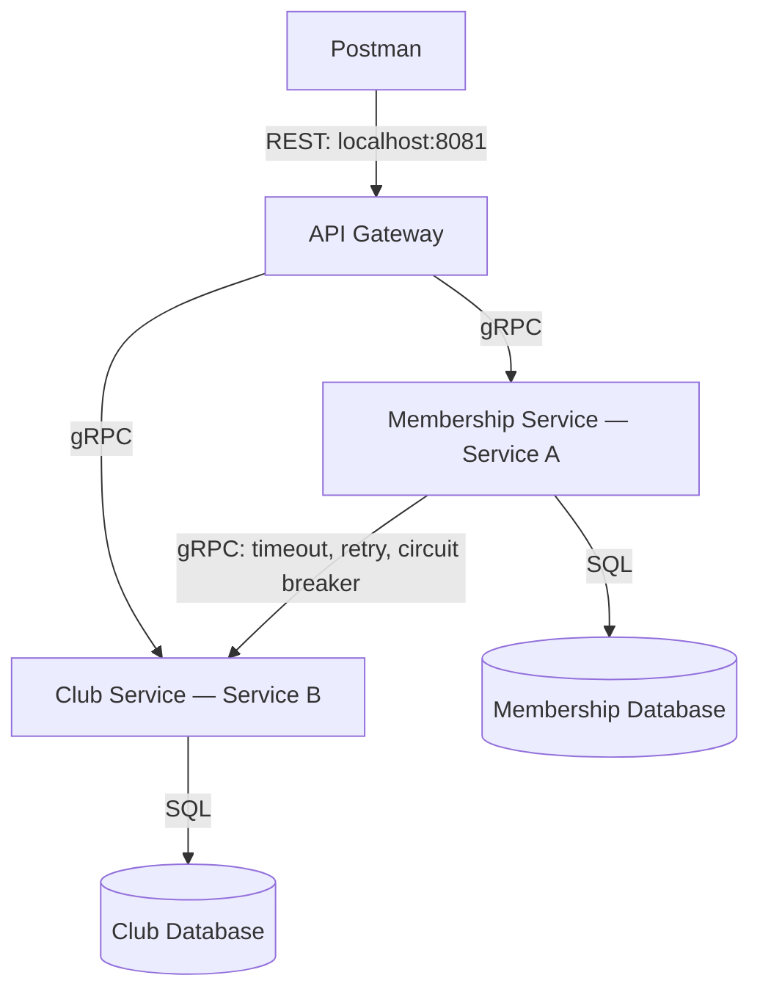

# Club Membership System

A Go application built for WEB303 Programming Assignment 1.

## Architecture



## Service Boundaries

- **Club Service** owns club records and accesses only the Club database.
- **Membership Service** owns membership records and accesses only the Membership database.
- Membership Service fetches club information through Club Service's gRPC API.
- The API Gateway provides the REST entry point and maps gRPC errors to HTTP status codes.
- Only the gateway publishes a host port. Services and databases communicate inside Docker's network.

## Requirements

- Docker Desktop with Docker Compose
- Postman desktop app, or a supported browser with Desktop Agent
- Go and protoc only if building locally or regenerating protobuf code

## Run the System

From the project folder, create the environment file:

```bash
cp .env.example .env
```

If you already have a configured `.env`, keep it.

The supplied configuration uses host port 8081. Ensure this port is available.

Start the complete application:

```bash
docker compose up -d --build
```

Check container status:

```bash
docker compose ps
```

Check the gateway:

```bash
curl -i http://localhost:8081/health
```

Expected response: HTTP 200 with:

```json
{
  "service": "api-gateway",
  "status": "ok"
}
```

The health endpoint checks that the gateway is running. It does not check downstream services.

Stop the application while preserving database data:

```bash
docker compose down
```

## Project Organization

| Path | Purpose |
|---|---|
| `cmd/club-service/` | Club server startup and multi-stage Dockerfile |
| `cmd/membership-service/` | Membership server startup and multi-stage Dockerfile |
| `cmd/api-gateway/` | Gateway startup and multi-stage Dockerfile |
| `internal/club/` | Club CRUD and validation |
| `internal/membership/` | Membership CRUD and validation |
| `internal/gateway/` | REST routes and gRPC error mapping |
| `internal/resilience/` | Timeout, retry, backoff, and circuit breaker |
| `internal/config/` | Environment configuration helpers |
| `proto/` | Protocol Buffer definitions and generated Go files |
| `database/` | Separate database initialization scripts |
| `postman/` | Exported Postman collection |
| `screenshots/` | Demonstration evidence |

## Resources

### Club

- `id`: generated positive integer
- `name`: required, maximum 100 characters
- `description`: optional, maximum 500 characters

### Membership

- `id`: generated positive integer
- `student_name`: required, maximum 100 characters
- `student_id`: exactly eight digits
- `club_id`: positive integer identifying an existing club

A student cannot have two memberships for the same club.

Club details in membership responses are fetched through gRPC and are not stored in the Membership database.

## REST Endpoints

Base URL: `http://localhost:8081`

| Method | Endpoint | Purpose | Success |
|---|---|---|---|
| GET | `/health` | Gateway health | 200 |
| POST | `/clubs` | Create club | 201 |
| GET | `/clubs` | List clubs | 200 |
| GET | `/clubs/{id}` | Retrieve club | 200 |
| PUT | `/clubs/{id}` | Update club | 200 |
| DELETE | `/clubs/{id}` | Delete club | 200 |
| POST | `/memberships` | Create membership | 201 |
| GET | `/memberships` | List memberships | 200 |
| GET | `/memberships/{id}` | Retrieve membership | 200 |
| PUT | `/memberships/{id}` | Update membership | 200 |
| DELETE | `/memberships/{id}` | Delete membership | 200 |

PUT requests provide all editable fields. The URL determines the record ID.

Empty list fields are omitted by the current JSON encoder, so an empty list response is `{}`.

## Example Requests

Create a club using POST `/clubs`:

```json
{
  "name": "Chess Club",
  "description": "Chess practice and college tournaments."
}
```

Use the returned club ID when creating a membership with POST `/memberships`:

```json
{
  "student_name": "Yeshey Lhaden",
  "student_id": "02240371",
  "club_id": 1
}
```

The example assumes the returned club ID is 1. Actual IDs may differ.

## Error Handling

| gRPC error | HTTP status | Example |
|---|---|---|
| InvalidArgument | 400 | Invalid student ID |
| NotFound | 404 | Missing club or membership |
| AlreadyExists | 409 | Duplicate membership |
| Unavailable | 503 | Dependency unavailable or circuit open |
| DeadlineExceeded | 504 | Dependency call timed out |
| Internal | 500 | Internal service failure |

The gateway also rejects malformed JSON, unknown fields, invalid path IDs, and oversized request bodies.

## Resilience

Membership Service applies resilience to its GetClub calls.

| Environment variable | Normal value | Meaning |
|---|---|---|
| `CLUB_CALL_TIMEOUT` | `2s` | Deadline for each attempt |
| `CLUB_MAX_ATTEMPTS` | `3` | Maximum attempts, including the initial call |
| `CLUB_RETRY_BACKOFF` | `200ms` | Initial retry delay |
| `CLUB_CIRCUIT_THRESHOLD` | `3` | Failed operations before opening |
| `CLUB_CIRCUIT_OPEN_DURATION` | `10s` | Waiting period before a recovery probe |
| `GATEWAY_REQUEST_TIMEOUT` | `10s` | Overall gateway RPC deadline |

Retries use delays of 200 ms and 400 ms. Only Unavailable and DeadlineExceeded errors are retried.

An operation counts as failed after its retry attempts are exhausted. InvalidArgument and NotFound errors are not retried.

While the circuit is open, calls are rejected immediately. After the waiting period, one half-open probe is allowed. A successful probe closes the circuit; another dependency failure reopens it.

## Demonstrate Dependency Failure

1. Create a club and a membership. Note their returned IDs.
2. Confirm GET `/memberships/{id}` succeeds.
3. Stop Club Service:

```bash
docker compose stop club-service
```

4. Retrieve the membership again through Postman.
5. Expect HTTP 503 or 504, depending on the gRPC failure.
6. Repeat failed requests to trigger the circuit breaker.
7. While the circuit is open, expect HTTP 503 with a circuit-open message.

Inspect logs:

```bash
docker compose logs --tail=80 membership-service
```

For easier screenshot capture, temporarily set `CLUB_CIRCUIT_OPEN_DURATION=60s` in `.env`, then apply it:

```bash
docker compose up -d --no-deps membership-service
docker compose restart api-gateway
```

Recreating Membership Service resets its circuit state. Confirm requests reach it before counting failed operations.

Restore Club Service:

```bash
docker compose start club-service
```

Allow the configured open period to expire, then retrieve the membership again. A successful recovery probe closes the circuit.

After demonstration, restore `CLUB_CIRCUIT_OPEN_DURATION=10s` and apply the normal configuration. Restarting Membership Service resets the circuit rather than demonstrating half-open recovery.

## Postman Collection

Import:

`postman/Club_Membership_System.postman_collection.json`

All requests call the API Gateway on port 8081.

Create records first and update request URLs and bodies with the returned IDs. Saved IDs from earlier demonstrations may refer to deleted records.

Run failure tests manually while stopping and restoring Club Service.

## Configuration and Deployment

Configuration comes from environment variables supplied by Docker Compose.

- `.env.example` contains reproducible local development settings.
- `.env` is excluded from Git.
- Each Go application has a multi-stage Dockerfile.
- The final images run as a non-root user.
- Each database has separate credentials and a persistent volume.
- Database initialization scripts run when their data volumes are first initialized.
- Internal gRPC addresses use Docker service names.
- The gateway has no database connection.

## Scope and Limitations

This assignment prototype does not include authentication or a user interface.

Club existence checks and membership writes are separate operations across services, not a distributed transaction. A club can therefore be deleted after it has been checked.

Deleting a club does not automatically delete memberships in the other database. Delete its memberships first. If a membership references a deleted club, retrieving it returns a club-not-found error.

Listing memberships performs one club lookup per membership and is intended for a small demonstration dataset.

## Local Compilation Checks

With Go installed:

```bash
go test ./...
go vet ./...
```

Packages without test files are compiled by `go test`; that output does not mean automated behavioural tests were executed. Functional behaviour is demonstrated through Postman requests and service logs.
